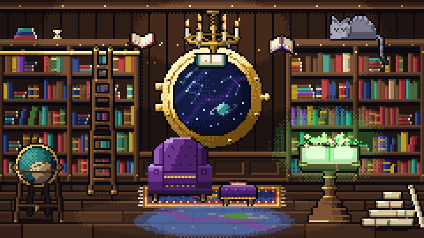
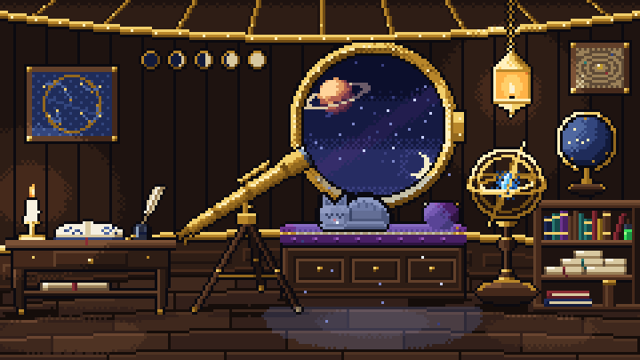
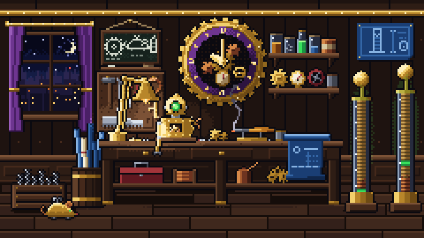
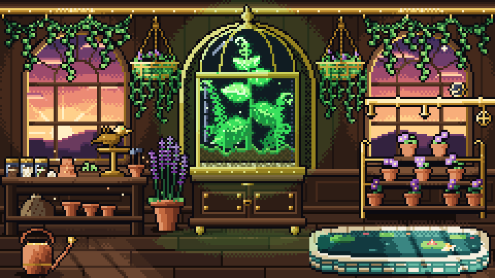
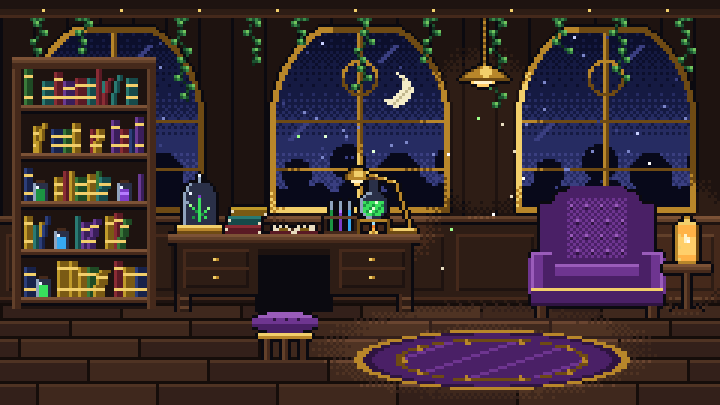
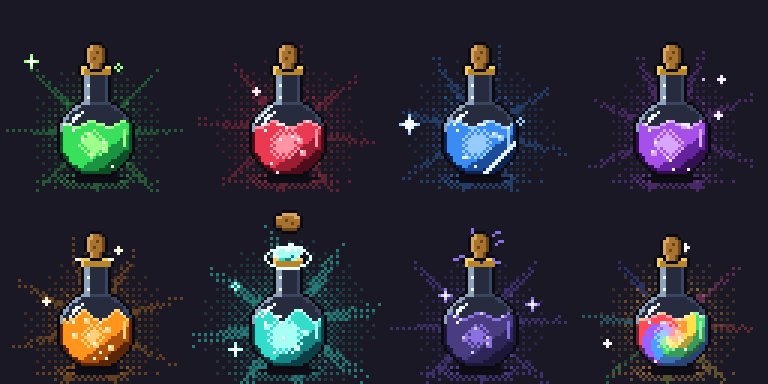
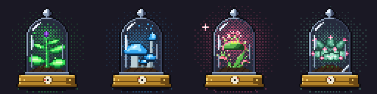
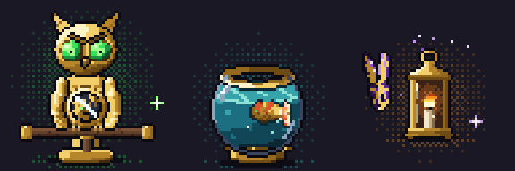

# Gallery

Rooms and animated props drawn by an AI agent (Claude) with PixelForge, from an art library made for games and videos. No image-generation model was used.

- **Sprites.** Python scripts the agent wrote generate each recipe and `pixelforge-fx` particle source. PixelForge validates, compiles and renders them to transparent sprite sheets with atlases.
- **Rooms.** Each room is a `pixelforge-scene` of 240×135 pixels that places a lit shell, its props, and light and particle effects. `pixelforge sequence` writes it as numbered frames and `pixelforge gif-frames` packs them.
- **Shelves.** Each 64×64 loop is placed on a dark backdrop, a few frames out of step with its neighbours, then packed with `gif-frames`.

The generator scripts belong to that library and are not in this repository. Every GIF here loops 48 frames of 70 ms (the potions 32), shown at 3× with exact colours.

## Rooms

**Library.** Books circle the chandelier, a lectern book turns its page in a burst of light, stained glass colours the floor and a grey tabby sleeps on a shelf. 122 colours.

**Observatory.** A porthole onto a ringed planet and a shooting star, a telescope with a lens flash, an armillary whose crystal blooms, a candle-lit desk and a cat asleep on the window seat. 97 colours.

**Workshop.** A half-built brass automaton blinks on the bench under a gear clock; glass coils arc and light the room while a clockwork mouse scurries across the floor. 145 colours.

**Conservatory.** A terrarium whose giant plant pulses and blooms, dawn windows with birds, hanging ivy and baskets, a misting pipe, a brass bird and a pond with a circling fish. 133 colours.

**Greenhouse lab.** Three gothic windows on a night garden, a bookshelf of glowing jars, a desk with a bell jar and test tubes, velvet chairs, fireflies and dust. 61 colours.

## Shelves

**Potions.** Bubbles, turning rays, dithered glow and sparkles; each cork rattles, pops, tumbles and lands. The rainbow potion turns six hue ramps in a spiral. 101–110 colours a frame, 474 in all, so each frame carries its own colour table.

**Bell jars.** A bud swells and blooms; glowcap mushrooms light in a wave and puff spores; a flytrap snaps a firefly and glows as it chews; a succulent breathes ring by ring and sheds dew.

**Familiars.** A brass owl spreads its bladed wings, a clockwork koi leaps from its bowl and a crystal moth flashes over a lantern.

## These files

The library's GIFs are 4×. GitHub shows a README in a column 838 pixels wide on a desktop screen and smooths any image it shrinks, so these copies were made at 3×. Each frame was decoded, checked to be an exact 4× enlargement, reduced to 3× by whole pixels and packed again with this repository's `gif-frames --fps 100/7`. Pillow decodes every frame back to the same pixels, with the same 70 ms delays.
